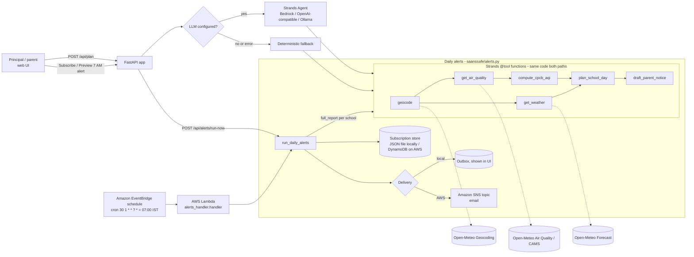

# SaansSafe (सांस सेफ) — school decisions for bad-air days

**Track:** Air · **Built with:** Strands Agents SDK (AWS open source) · Amazon Bedrock (optional) · Amazon EventBridge + AWS Lambda + DynamoDB + SNS for daily alerts · deployable via AWS SAM / App Runner

## The problem
Every winter, and on dust-storm days, many North Indian cities see "Poor" to "Severe" air quality. Authorities in Delhi-NCR have suspended or moved school classes online on severe-AQI days under the Graded Response Action Plan (GRAP). On every other bad-air day, a principal still has to decide at 7 AM: *hold assembly outside? cancel sports? what do I tell parents?* The data exists (AQI apps, forecasts), but it isn't turned into a school decision, and it is rarely in Hindi.

Children are especially vulnerable to air pollution (WHO, *Air pollution and child health*, 2018), and CPCB's own AQI health statements flag children and people with asthma from the "Moderate" category upward.

## What it does
Enter a city or locality (and school hours). SaansSafe returns:
- **CPCB AQI hero card** (24-hour average, PM2.5/PM10), coloured by CPCB category, with CPCB's health statement
- **Today's decision**: normal / shorten outdoor time / move indoors / indoor-only / consider online classes
- **Hourly chart with the safe outdoor window** within school hours (AQI ≤ 200 and feels-like < 40 °C)
- **Mask, indoor-air, asthma and heat precautions**
- **7-day outlook** marking days to plan indoor activities
- **Bilingual parent notice** (English + Hindi) with Copy and **Share on WhatsApp**
- **Listen** buttons that read each notice aloud in the browser (Web Speech API, `hi-IN` for Hindi, `en-IN` for English) with Play/Stop, for parents who prefer audio; a hint appears if the device has no Hindi voice
- **District view**: paste several localities/schools, get a ranked table of who needs an indoor schedule today
- **Daily 7 AM alerts**: subscribe a school (name, locality, optional email or WhatsApp number). Every day at 07:00 IST a scheduled job builds each school's plan and bilingual notice and delivers it. Locally it goes to an outbox shown in the UI; on AWS, an EventBridge schedule triggers a Lambda that reads subscribers from DynamoDB and publishes to SNS (email). **Preview tomorrow's 7 AM alert** runs the same job on demand

## How it works

**Rules decide, the model explains.** All numbers and decisions come from deterministic tools, so the same data always gives the same plan and nothing is invented. When an LLM is configured, a Strands agent calls those same tools and writes a conversational summary. If no key is set or the model call fails, the app silently uses the template path, so the demo never breaks.

## Where AWS fits
- **Strands Agents SDK** (AWS open source) is the agent framework: six `@tool` functions in `saanssafe/tools.py`, agent in `saanssafe/agent.py`.
- **Amazon Bedrock** is the default model provider when AWS credentials are present (`BEDROCK_MODEL_ID`, default Amazon Nova Lite).
- **Daily alerts on AWS** (`template.yaml`): an **Amazon EventBridge** schedule `cron(30 1 * * ? *)` (01:30 UTC = 07:00 IST) triggers the **AWS Lambda** `DailyAlertsFunction` (`alerts_handler.handler`), which reads subscribers from an **Amazon DynamoDB** table (on-demand billing) and publishes each alert to an **Amazon SNS** topic (email). The web Lambda writes subscriptions to the same table. Store and delivery are pluggable: set `SUBSCRIPTIONS_TABLE` to use DynamoDB and `ALERTS_TOPIC_ARN` to use SNS; without them the app uses `data/subscriptions.json` and `data/outbox.json`.
- **Deploy**: `template.yaml` (AWS SAM → web Lambda + Function URL via Mangum, alert Lambda, schedule, table, topic; optional `AlertEmail` parameter subscribes an email to the topic) or `Dockerfile` (AWS App Runner). Not deployed by default. The template passes `cfn-lint`.

## Run locally
```bash
python -m venv .venv && source .venv/bin/activate
pip install -r requirements.txt
cp .env.example .env        # optional; with no keys it runs in deterministic mode
uvicorn app:app --port 8000  # open http://localhost:8000
# CLI: python -m saanssafe.agent Delhi
# run the 7 AM job once locally: python -c "from saanssafe.alerts import run_daily_alerts as r; print(r()['sent'])"
# tests: pip install pytest && python -m pytest -q tests
```
Provider selection (`SAANSSAFE_PROVIDER=auto`): Bedrock if AWS creds exist → OpenAI-compatible if `OPENAI_API_KEY` → Ollama if `OLLAMA_HOST` → deterministic.

### Deploy (optional)
```bash
sam build && sam deploy --guided          # web Lambda + Function URL, 7 AM alert Lambda, EventBridge schedule, DynamoDB, SNS
# or: docker build -t saanssafe . and deploy the image with AWS App Runner (port 8080)
```

## CPCB National AQI breakpoints used (24-hr avg, µg/m³)
| Category | AQI | PM2.5 | PM10 |
|---|---|---|---|
| Good | 0–50 | 0–30 | 0–50 |
| Satisfactory | 51–100 | 31–60 | 51–100 |
| Moderate | 101–200 | 61–90 | 101–250 |
| Poor | 201–300 | 91–120 | 251–350 |
| Very Poor | 301–400 | 121–250 | 351–430 |
| Severe | 401–500 | 250+ | 430+ |

AQI = max of the sub-indices, linearly interpolated within each band. Source: Central Pollution Control Board, *National Air Quality Index* (2014), https://cpcb.nic.in/National-Air-Quality-Index/ . Health statements in the UI are paraphrased from the same CPCB document.

## Decision rules (summary)
Level = CPCB category of the 24-h average, raised by one step less than the worst forecast hour in school hours. Good/Satisfactory → normal; Moderate → shorten outdoor time, asthma kids indoors for PE; Poor → indoor assembly and sports; Very Poor → indoor-only, windows shut; Severe → follow CAQM/GRAP and state directives, consider online/hybrid classes. Heat precautions at feels-like ≥ 35 °C / ≥ 40 °C.

## Data sources
- Open-Meteo Geocoding API, Weather Forecast API, Air Quality API (CAMS global model), no key required — https://open-meteo.com
- CPCB National AQI · WHO, *Air pollution and child health: prescribing clean air* (2018) · WHO Global Air Quality Guidelines (2021)

## Limitations
- Air quality comes from the **CAMS forecast model (~11–40 km grid)**, not CPCB ground monitors; neighbouring localities can differ from station readings, and modelled PM10 can spike during dust events. Use it for planning, and check official CPCB/SAMEER readings for formal decisions.
- Only PM2.5 and PM10 are used (CPCB's AQI also covers NO₂, O₃, SO₂, CO, NH₃, Pb). Hourly values are indicative sub-indices.
- The forecast horizon is about 5 days, so the last outlook days may show "No forecast".
- SNS email delivery sends one message per alert to everyone confirmed on the topic; per-school email/WhatsApp routing (SNS per-recipient, SES or WhatsApp Business API) is a next step. WhatsApp numbers are stored but not messaged automatically.
- Read-aloud quality depends on the voices installed on the device. Chrome and Android usually have a Hindi voice; some desktops don't, and the browser's default voice is then used.
- Guidance is general, not medical advice. Hindi text is template-generated; have a native speaker review it before wide use.
